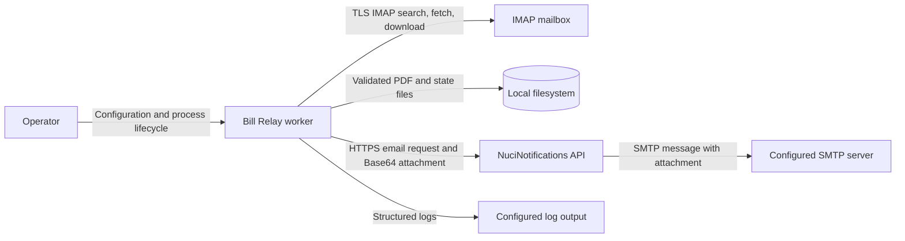
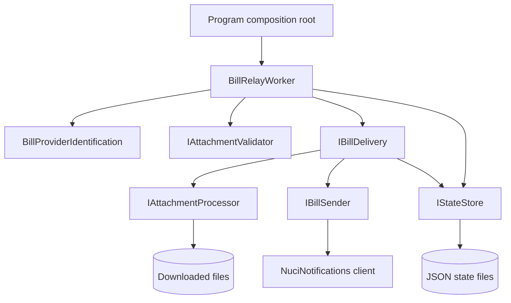
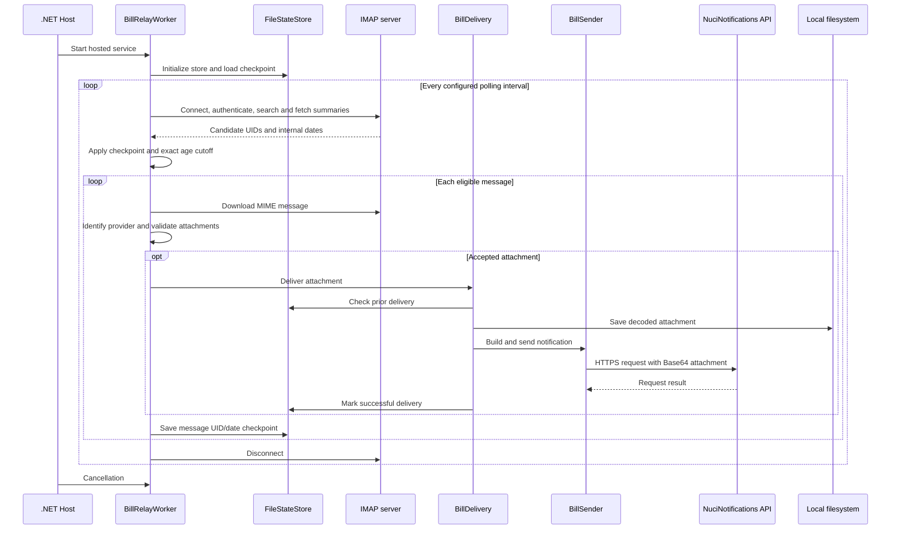
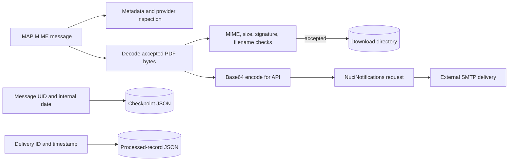
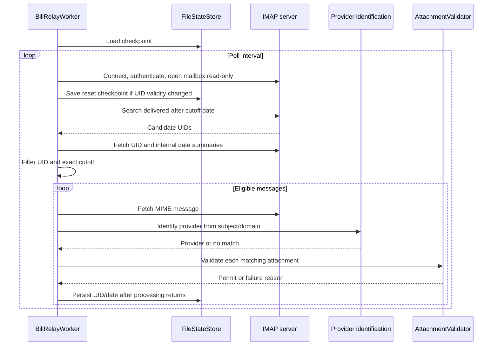
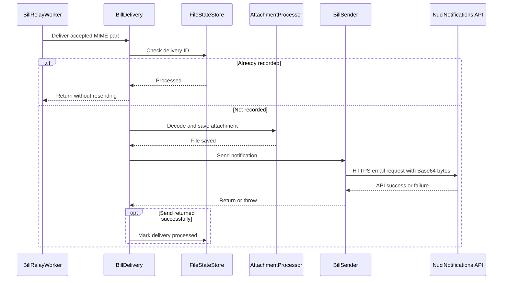
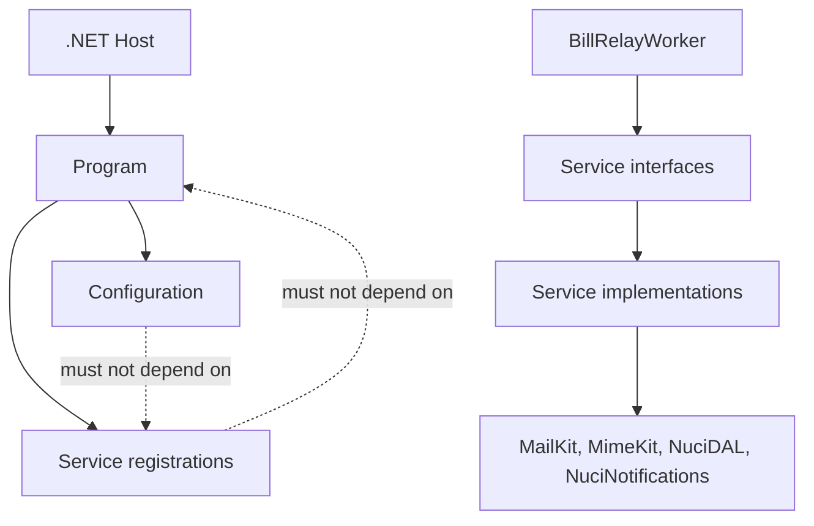

# Bill Relay Architecture

This document describes the current architecture of the Bill Relay .NET 10 worker and its repository-owned boundaries. External IMAP, notification API, and SMTP internals are described only at their integration boundary.

## 📑 Table of Contents

- [Purpose](#purpose)
- [System Context](#system-context)
- [Architectural Style](#architectural-style)
- [Runtime Flow](#runtime-flow)
- [Components](#components)
- [Architectural Areas](#architectural-areas)
  - [Composition and Configuration](#composition-and-configuration)
  - [Inbox Processing](#inbox-processing)
  - [Delivery and Persistence](#delivery-and-persistence)
- [Data Architecture](#data-architecture)
- [Interfaces and Integrations](#interfaces-and-integrations)
- [Key Flows](#key-flows)
  - [Inbox Poll and Classification](#inbox-poll-and-classification)
  - [Attachment Delivery](#attachment-delivery)
- [Provider Identification and Checkpointing](#provider-identification-and-checkpointing)
- [Cross-Cutting Concerns](#cross-cutting-concerns)
  - [Security and Privacy](#security-and-privacy)
  - [Error Handling](#error-handling)
  - [Observability](#observability)
  - [Configuration](#configuration)
  - [Concurrency and Resource Use](#concurrency-and-resource-use)
- [Dependency Direction and Rules](#dependency-direction-and-rules)
- [External Dependencies](#external-dependencies)
- [Deployment and Operations](#deployment-and-operations)
- [Compatibility Contracts](#compatibility-contracts)
- [Testing and Verification](#testing-and-verification)
- [Design Constraints](#design-constraints)
- [Extension Points](#extension-points)
    - [Provider Support](#provider-support)
    - [Delivery Implementation](#delivery-implementation)
- [Source Map](#source-map)
- [Related Documentation](#related-documentation)

## 🎯 Purpose

Bill Relay monitors one configured IMAP mailbox, identifies supported utility-bill messages, validates matching PDF attachments, saves accepted files, and submits them to the configured NuciNotifications API for email delivery. This document records the implemented system boundary, runtime ownership, persistence and delivery behavior, and constraints for maintainers changing the service.

## 🌐 System Context

The process is a self-hosted .NET worker. An operator supplies configuration and starts the process. Bill Relay reads mailbox data from an IMAP server, writes attachments and state to the local filesystem, sends email requests with PDF bytes to NuciNotifications, and emits structured logs. The NuciNotifications API owns SMTP delivery and interactions with the destination mail system.



The principal external boundaries are:
- **IMAP server:** Supplies message summaries and complete MIME messages; connection credentials and certificate policy are configured by the operator.
- **Local filesystem:** Stores downloaded attachments, processed-delivery records, and a separate IMAP checkpoint file.
- **NuciNotifications API:** Receives sender, recipient, subject, body, and optional attachment filename/Base64 content over HTTPS; the API owns SMTP submission.
- **Logging output:** Receives structured operational events; logger configuration determines output and minimum level.
- **Operator:** Owns configuration, credentials, filesystem access, process lifecycle, and downstream SMTP configuration.

## 🏗️ Architectural Style

Bill Relay is a single-process hosted worker organized as a small service-oriented pipeline. `Program` is the composition root; `BillRelayWorker` owns polling and orchestration; focused services own provider identification, attachment validation and saving, notification submission, and state persistence. Interfaces (`IStateStore`, `IBillDelivery`, `IBillSender`, `IAttachmentProcessor`, and `IAttachmentValidator`) separate these responsibilities at their collaboration boundaries.



The principal architecture boundaries are:
- **Composition:** `Program` loads configuration, validates notification endpoint credentials, registers singleton collaborators, and starts the hosted worker.
- **Orchestration:** `BillRelayWorker` owns IMAP connection and mailbox iteration, evaluates message eligibility, and coordinates classification, validation, delivery, and checkpoint updates.
- **Attachment handling:** `BillProviderIdentification`, `IAttachmentValidator`, and `IAttachmentProcessor` classify provider patterns, validate content, and write accepted files.
- **Delivery:** `BillDelivery` coordinates deduplication, local saving, and `BillSender`; `BillSender` builds the email and delegates to NuciNotifications.
- **Persistence:** `FileStateStore` owns JSON repository records, checkpoint file reads/writes, and retention operations.

## 🔄 Runtime Flow



The principal runtime sequence is:
1. The host builds the application, loads `appsettings.json` from `AppContext.BaseDirectory`, then applies environment variables and starts the hosted service.
2. The worker validates delivery and polling configuration, initializes state storage, and loads the IMAP UID checkpoint.
3. Each poll opens a fresh IMAP client, authenticates, opens the configured mailbox read-only, searches from the effective cutoff, fetches summaries, and filters by UID and internal date.
4. Eligible messages are classified. Matching attachments are checked against provider filename/MIME rules and content type, size, and PDF signature rules; accepted files are saved and sent through NuciNotifications.
5. After message processing returns, the worker persists that message's UID and internal date. Cancellation stops the loop and the client is disconnected.

## 🧩 Components

| Component | Responsibility | Principal Dependencies | Lifetime or Ownership |
|-----------|----------------|------------------------|-----------------------|
| `Program` | Configuration, validation, DI registration, and host startup. | .NET hosting/configuration, NuciLog, NuciNotifications | Process composition root. |
| `BillRelayWorker` | Polling and mailbox/message orchestration. | IMAP MailKit, settings, logger, state, delivery, validator | Hosted singleton for process lifetime. |
| `BillProviderIdentification` | Subject/domain/provider and provider-specific filename matching. | MimeKit, regular expressions | Static domain logic. |
| `AttachmentValidator` | MIME allowlist, content-stream size limit, and PDF signature checks. | Settings, MimeKit | Registered singleton. |
| `AttachmentProcessor` | Decode, write temporary file, and atomically finalize a bill file. | Filesystem, SHA-256, settings, logger | Registered singleton. |
| `BillDelivery` | Delivery deduplication, attachment saving, notification call, and processed marker. | Attachment processor, sender, state, logger, settings | Registered singleton. |
| `BillSender` | Template expansion and Base64 attachment request construction. | NuciNotifications client, settings, logger | Registered singleton. |
| `FileStateStore` | JSON processed-record repository and IMAP checkpoint persistence. | NuciDAL, filesystem, settings, logger | Registered singleton; repository initialized on worker startup. |

## 🗂️ Architectural Areas

### Composition and Configuration

Paths:
- `BillRelay/Program.cs`
- `BillRelay/Configuration/`

Responsibilities:
- Load runtime JSON from the application output directory, with environment-variable overrides.
- Bind `BillRelaySettings` and `NuciNotificationsSettings`.
- Require an absolute HTTPS NuciNotifications base URL and non-empty API/HMAC credentials.
- Register worker collaborators and run the generic host.

Boundary rules:
- Configuration types do not depend on service implementations; this is enforced by architecture tests.
- Services do not reference the composition root; this is enforced by architecture tests.
- Secrets must be supplied by deployment configuration and must not be committed.

### Inbox Processing

Paths:
- `BillRelay/Services/BillRelayWorker.cs`
- `BillRelay/Services/BillProviderIdentification.cs`
- `BillRelay/Services/EmailAgePolicy.cs`
- `BillRelay/Services/Attachments/`

Responsibilities:
- Connect and authenticate to IMAP, search and fetch summaries, load eligible messages, and disconnect.
- Apply the configured age window, optional initial processing date, and persisted checkpoint.
- Identify supported bill providers and validate their attachment patterns and content.

Boundary rules:
- The worker owns IMAP lifecycle and message-level orchestration.
- Provider matching is deterministic code, not dynamically driven by the configured provider array alone; a provider must also be implemented in `BillProviderIdentification`.
- The mailbox is opened read-only. The worker does not move, delete, or mark messages as read.

### Delivery and Persistence

Paths:
- `BillRelay/Services/BillDelivery.cs`
- `BillRelay/Services/BillSender.cs`
- `BillRelay/Services/AttachmentProcessor.cs`
- `BillRelay/Services/FileStateStore.cs`
- `BillRelay/DataAccess/DataObjects/`

Responsibilities:
- Store accepted attachments under the configured download directory using a temporary file and final move.
- Send the decoded attachment bytes as a Base64 request to NuciNotifications.
- Store processed delivery records and the mailbox checkpoint in local files.

Boundary rules:
- `BillDelivery` marks delivery state only after `BillSender.SendAsync` returns successfully.
- A send exception is logged and rethrown by `BillDelivery`, but caught by `BillRelayWorker.DeliverAttachmentAsync`; mailbox processing then continues and the message checkpoint is advanced. Therefore a send failure is not automatically retried on later polls after that checkpoint advances.
- The state-store retention operation exists, but the worker currently does not invoke it.

## 💾 Data Architecture

Message content enters as MIME data from IMAP. The worker inspects message subject, sender, body, internal date, and attachments. Attachment bytes are decoded from MIME transfer encoding for validation and local saving; `BillSender` independently decodes the attachment and Base64-encodes its bytes for the NuciNotifications JSON request.

Local state consists of a `NuciDAL` JSON repository at `storage.stateFilePath` and an IMAP checkpoint at the same path with the `.checkpoint` suffix. The repository records delivery IDs, source message IDs, and processing timestamps. The checkpoint records mailbox `UidValidity`, last processed UID, and last processed internal date. Checkpoint writes use a temporary sibling file followed by replacement. The worker advances the checkpoint after each eligible message's processing call returns, including messages without a supported provider or attachment.



| Data or Store | Owner | Representation and Storage | Lifecycle or Consistency |
|---------------|-------|----------------------------|--------------------------|
| IMAP message | IMAP server; inspected by worker | MIME message, materialized in process memory | Fetched when UID is above checkpoint and internal date is within cutoff. |
| Bill attachment | Attachment processor and sender | Decoded bytes; local file and separately Base64-encoded API field | Written before notification submission; local file remains according to operator cleanup and retention practices. |
| Processed delivery record | `FileStateStore` | JSON entity with delivery ID, message ID, and UTC processing time | Added only after successful sender return; duplicate delivery IDs are ignored by `TryAdd`. |
| IMAP checkpoint | `BillRelayWorker` / `FileStateStore` | JSON object with UID validity, UID, and internal date | Replaced after each eligible message's processing call returns; reset when UID validity changes. |

## 🔌 Interfaces and Integrations

| Interface or Integration | Direction | Contract | Owner | Failure Semantics |
|--------------------------|-----------|----------|-------|-------------------|
| IMAP | Outbound | MailKit connection using configured host, port, SSL, mailbox, and credentials; read-only mailbox. | `BillRelayWorker` | Poll-level exception is logged; next polling cycle continues unless cancellation is requested. |
| `IStateStore` | Internal | Initialize, get/save checkpoint, query/mark delivery state, and apply retention. | `FileStateStore` | File/repository exceptions propagate to the worker poll boundary or delivery boundary. |
| `IAttachmentValidator` | Internal | Return permit status and a diagnostic failure reason for a MIME entity. | `AttachmentValidator` | Rejection prevents delivery; reason is logged by the worker. |
| `IAttachmentProcessor` | Internal | Decode and persist accepted attachment bytes. | `AttachmentProcessor` | Write failure is logged and rethrown; no send is attempted. |
| NuciNotifications | Outbound HTTPS | `SendEmail` with sender name, recipient, subject, body, and ordered attachment records containing filename and Base64 bytes. | `BillSender` and external client | Client exceptions propagate through delivery, are logged by the worker, then message processing continues. |
| SMTP | Outbound from NuciNotifications | API-owned SMTP message delivery. | NuciNotifications API | Outside this repository's control; Bill Relay observes only API request success/failure. |

## 🔀 Key Flows

### Inbox Poll and Classification



The IMAP `DeliveredAfter` query uses the UTC date of the cutoff as a coarse server-side search. The worker applies the exact `InternalDate` lower cutoff after fetching summaries. The effective lower cutoff is the latest of `current time - maximumEmailAgeDays`, `initialProcessingDate`, and `checkpoint.LastProcessedDate`. Candidate query results are filtered by UID greater than `LastProcessedUid`. The worker does not apply a separate upper-bound check against the current time.

### Attachment Delivery



The API success response means the notification API accepted/completed its SMTP operation according to that service's contract; Bill Relay cannot verify recipient inbox presentation. A send error is logged and rethrown from `BillDelivery`, then caught by `BillRelayWorker`; the worker still advances the message checkpoint after `ProcessMessageAsync` returns. Consequently, a transient send failure does not automatically retry that message on the next poll. The saved local attachment can be used for manual recovery.

## ⚙️ Provider Identification and Checkpointing

Provider identification first requires a billing-related subject. It recognises providers from configured website domains in message links or sender addresses; Hidroelectrica is also identified when its name appears in the subject. The provider must be enabled in `filters.providers`. Provider-specific PDF filename expressions are implemented in `BillProviderIdentification`; unknown providers and unrecognized filename patterns are rejected.

The checkpoint is scoped by IMAP `UidValidity`. When that value changes, the UID and date checkpoint are reset. For the current mailbox validity, messages at or below the last saved UID are skipped. The checkpoint is persisted after each eligible message returns from provider/attachment processing. Since provider misses and attachment rejections return normally, those messages are checkpointed too.

## 🧵 Cross-Cutting Concerns

### Security and Privacy

IMAP access uses configured credentials. NuciNotifications configuration requires an absolute HTTPS URL and non-empty API key and HMAC shared secret. The service validates TLS certificates by default; configuration can disable certificate validation, which permits untrusted certificates and should not be used in normal deployments. Attachments and state are stored locally. Recipient and operational log fields are passed through NuciLog's sensitive-field mechanism where marked by `LogInfoKey`. Secrets must be supplied outside version-controlled configuration.

### Error Handling

Startup validation errors prevent the host from running. Cancellation requested by the host exits the polling loop. Other polling exceptions are logged at the inbox boundary, then the worker proceeds to a later poll. Attachment write failures are logged and rethrown. Notification delivery exceptions are logged and rethrown by `BillDelivery`, then logged by the worker and swallowed at the per-attachment boundary. The worker subsequently advances the message checkpoint, so failed sends are not automatically retried. Attachment validation failures are logged and skipped.

### Observability

NuciLog emits structured lifecycle, mailbox count, provider recognition, attachment validation, local save, notification request, and failure events. Detailed subject/sender/provider rejection diagnostics are Debug-level; operational success is Info-level and exceptions are Error-level. The configured logger controls output destination and minimum level. Current worker logs do not expose the exact computed cutoff or the individual reason why a subject/domain failed provider identification.

### Configuration

| Configuration Area | Source | Responsibility | Override or Secret Policy |
|--------------------|--------|----------------|---------------------------|
| Host configuration | `BillRelay/appsettings.json`, environment variables | Loads service settings from the application output directory and applies environment overrides. | Environment variables are loaded after JSON and override matching values. |
| Bill Relay settings | `delivery`, `imap`, `polling`, `filters`, `attachments`, `storage`, `retention` sections | Controls mailbox, eligibility, matching, file validation, persistence, and destination. | IMAP password and recipient configuration must not be committed as secrets or personal data. |
| NuciNotifications settings | `NuciNotificationsSettings` section | Controls API URL and client authentication. | HTTPS is required; API key and HMAC secret must be injected as secrets. |
| Logger settings | `NuciLoggerSettings` section | Controls structured logging. | Sensitive values rely on the configured logger's masking behavior. |

### Concurrency and Resource Use

The hosted worker processes polls and eligible messages sequentially. Each poll creates one `ImapClient`; it disconnects in a `finally` block. Attachments and API payloads are buffered in memory for PDF signature checking and Base64 encoding; the configured maximum decoded attachment size bounds accepted input. No queue or parallel message processing is implemented.

## 🧭 Dependency Direction and Rules

The composition root references configuration and service implementations to register them. The worker depends on service interfaces and configuration. Service implementations depend on configuration, domain utilities, and external library abstractions; configuration does not depend on services. Architecture tests enforce that configuration has no service dependency, services do not reference `Program`, and production has no database provider dependency.



The principal dependency rules are:
- Configuration types do not depend on service implementations or persistence.
- Services do not depend on the composition root.
- Production persistence uses file-backed JSON through NuciDAL; database providers are prohibited by architecture tests.
- Test projects reference production code; production has no project reference to tests.

## 📦 External Dependencies

| Dependency | Responsibility | Integration Boundary | Architectural Consequence |
|------------|----------------|----------------------|---------------------------|
| .NET Generic Host and configuration | Process lifetime, hosted worker, JSON and environment configuration | `Program` and `BillRelayWorker` | Worker lifecycle and configuration behavior follow .NET hosting conventions. |
| MailKit | IMAP connection, search, fetch, and message retrieval | `BillRelayWorker` | Mailbox behavior and UID semantics depend on IMAP server and MailKit. |
| MimeKit | MIME message, body, and attachment representation | Worker and attachment services | Bill identification and validation operate on MIME entities. |
| NuciDAL | JSON repository for processed delivery records | `FileStateStore` | Delivery state is file-backed; no database transaction spans filesystem and API delivery. |
| NuciLog | Structured logging | All operational services | Log levels and masking depend on the logger implementation/configuration. |
| NuciNotifications.Client | Authenticated HTTPS notification request | `BillSender` | SMTP delivery is delegated outside the process. |

## 🚀 Deployment and Operations

Bill Relay runs as one .NET worker process. The application configuration file and linked email template are copied to the application output directory. Deployment requires filesystem access for downloaded PDFs and JSON state, outbound network access to the IMAP server and NuciNotifications HTTPS endpoint, and valid credentials for both integrations. SMTP host configuration belongs to NuciNotifications, not Bill Relay.

| Concern | Current Design | Architectural Consequence |
|---------|----------------|---------------------------|
| Process topology | One hosted worker in one .NET process | No independent worker scaling or distributed coordination is implemented. |
| Mailbox access | One read-only IMAP mailbox connection per poll | The process does not mutate mailbox flags or folders. |
| Local state | JSON files under configured paths | Backups, permissions, and disk availability are operator responsibilities. |
| Checkpoint recovery | Persisted `UidValidity`, UID, and message date | Mailbox UID validity changes reset the checkpoint and trigger a new scan in the age window. |
| Retention | Retention policy method and settings exist in state service | The worker does not currently call the retention operation. |
| Shutdown | Host cancellation is propagated through asynchronous operations | Active operations receive the stopping token; the process exits after cancellation handling. |

## 🛡️ Compatibility Contracts

| Contract | Owner | Invariant | Verification | Change Policy |
|----------|-------|-----------|--------------|---------------|
| Configuration JSON keys | `BillRelay.Configuration` | Section and key names bind to the documented configuration properties. | `BillRelay.IntegrationTests/Configuration/BillRelaySettingsTests.cs` | Preserve keys or migrate configuration and tests together. |
| Provider names and attachment patterns | `BillProviderIdentification` | Provider names, domains, subject matching, and filenames determine eligibility. | `BillRelay.UnitTests/Services/BillProviderIdentificationTests.cs` and local `.eml` integration test | Add a provider's identification and attachment pattern together with sample-based tests. |
| Notification request | `BillSender` and NuciNotifications client | Attachment list uses filename and Base64 bytes; sender, recipient, subject, and body are sent through the client contract. | `BillRelay.IntegrationTests/Services/BillSenderTests.cs` | Coordinate changes with the NuciNotifications API/client contract. |
| Checkpoint JSON | `ImapCheckpoint` and `FileStateStore` | UID validity, last processed UID, and last processed date determine scan progress. | File-state and worker tests | Preserve backward-compatible deserialization or migrate existing checkpoint files. |
| Processed delivery IDs | `BillDelivery` and `FileStateStore` | Delivery record ID is prefixed with `delivery:` and derives from the attachment ID. | `BillRelay.UnitTests/Services/BillDeliveryTests.cs` and state-store tests | Changing the identifier scheme may cause duplicate sends or missed deduplication. |

## ✅ Testing and Verification

The solution separates unit tests for service behavior, integration tests for configuration, local file persistence, email sender request mapping, and optional local `.eml` samples, and architecture tests for dependency direction and forbidden database dependencies. The example-email integration test is ignored unless `BILLRELAY_EXAMPLE_DIRECTORY` points to local samples. No live IMAP, NuciNotifications API, or SMTP end-to-end test is included in the repository suite.

Execute the principal automated verification with:

```bash
dotnet test
```

## ⚠️ Design Constraints

- **Sequential polling:** Polls and message processing are sequential; throughput is bounded by mailbox and remote API latency.
- **Checkpoint advancement after delivery errors:** Delivery failures are logged, but the per-attachment worker boundary catches them and message checkpointing proceeds. Automatic retry is therefore not guaranteed after the checkpoint advances.
- **Local persistence:** Downloaded files and state are stored on the local filesystem; shared/distributed storage coordination is not implemented.
- **Provider-specific matching:** Provider support requires explicit code and patterns; adding a provider only to configuration does not implement its message or attachment recognition.
- **No automatic retention execution:** Retention is available as a state-store operation but is not called by the worker.

## 🔧 Extension Points

### Provider Support

1. Add provider identification and supported domains or subject rules in `BillProviderIdentification`.
2. Add the provider name to the configured provider list and implement its attachment filename expression.
3. Add unit cases and a representative local `.eml` sample when available.

Provider behavior must preserve exact MIME type checks, PDF signature validation, maximum size enforcement, and case-insensitive configured-provider matching.

### Delivery Implementation

1. Implement `IBillSender` for an alternative notification transport.
2. Register the implementation in `Program.ConfigureServices`.
3. Preserve attachment byte fidelity, cancellation behavior, and the delivery-state rule that only completed sends are marked processed.

The existing `BillDelivery` coordinates `IAttachmentProcessor`, `IBillSender`, and `IStateStore`; changing that boundary requires updating its tests and delivery failure semantics.

## 🗺️ Source Map

| Area | Path |
|------|------|
| Composition and settings | `BillRelay/Program.cs`, `BillRelay/Configuration/` |
| Mailbox orchestration | `BillRelay/Services/BillRelayWorker.cs` |
| Provider identification | `BillRelay/Services/BillProviderIdentification.cs` |
| Attachment validation and persistence | `BillRelay/Services/Attachments/`, `BillRelay/Services/AttachmentProcessor.cs` |
| Delivery and notification client | `BillRelay/Services/BillDelivery.cs`, `BillRelay/Services/BillSender.cs` |
| State persistence | `BillRelay/Services/FileStateStore.cs`, `BillRelay/Services/ImapCheckpoint.cs`, `BillRelay/DataAccess/DataObjects/` |
| Unit tests | `BillRelay.UnitTests/` |
| Integration tests | `BillRelay.IntegrationTests/` |
| Architecture tests | `BillRelay.ArchitectureTests/` |

## 📚 Related Documentation

- [README.md](README.md) describes setup, configuration, operation, and contribution guidance.
- [NuciNotifications API reference](https://github.com/hmlendea/nucinotifications-api/blob/master/docs/api.md) documents the external email request contract.
