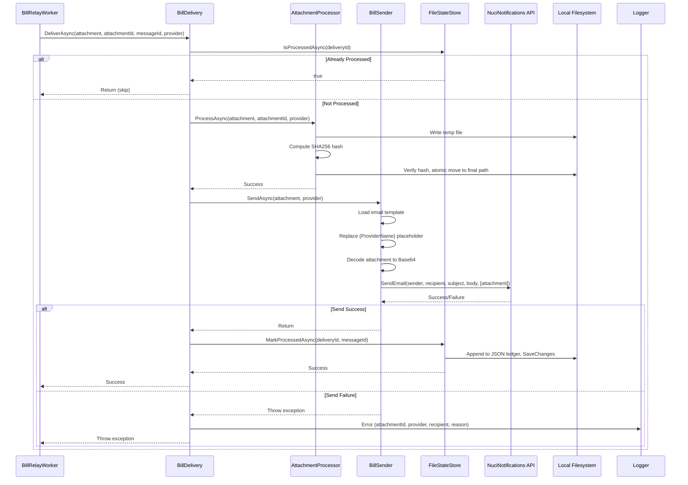

# Attachment Delivery Flow

## Overview

Documents the end-to-end attachment processing pipeline: file storage, deduplication, email sending, and state persistence.

## Sequence Diagram



## Detailed Steps

### 1. Delivery Entry Point

```csharp
// In BillRelayWorker.DeliverAttachmentAsync
using var stream = new MemoryStream();
await attachment.Content.DecodeToAsync(stream, cancellationToken);
stream.Position = 0;

var attachmentId = await _attachmentProcessor.ProcessAsync(stream, attachment.FileName, provider, cancellationToken);

if (await _stateStore.IsProcessedAsync(attachmentId)) return;

await _billDelivery.DeliverAsync(attachmentId, provider, messageId, cancellationToken);
await _stateStore.MarkProcessedAsync(new ProcessedAttachmentDataObject
{
    AttachmentId = attachmentId,
    FileName = attachment.FileName,
    FilePath = Path.Combine(_storageSettings.DownloadDirectory, $"{provider}_{attachment.FileName}"),
    ProviderName = provider.ToString(),
    MessageId = messageId,
    ProcessedAt = DateTimeOffset.UtcNow,
    FileSizeBytes = stream.Length
});
```

**Note:** Current implementation calls `AttachmentProcessor.ProcessAsync` in the worker BEFORE `BillDelivery.DeliverAsync`. The `BillDelivery` interface assumes file is already stored.

### 2. Attachment Processing (`AttachmentProcessor.ProcessAsync`)

```csharp
public async Task<string> ProcessAsync(
    Stream content, string originalFileName, string providerName, CancellationToken ct)
{
    // 1. Compute SHA256 (AttachmentId)
    var hashBytes = await sha256.ComputeHashAsync(content, ct);
    var attachmentId = Convert.ToHexString(hashBytes).ToLowerInvariant();
    content.Position = 0;

    // 2. Sanitize filename
    var safeName = SanitizeFileName(originalFileName);

    // 3. Prefix with provider
    var prefixedName = $"{providerName}_{safeName}";
    var targetPath = Path.Combine(_storageSettings.DownloadDirectory, prefixedName);

    // 4. Deduplication: check existing file hash
    if (File.Exists(targetPath))
    {
        var existingHash = await ComputeFileHashAsync(targetPath, ct);
        if (existingHash == attachmentId)
        {
            // Identical content exists, skip write
            return attachmentId;
        }
        // Different content, same name → will get unique path
    }

    // 5. Atomic write: temp → verify → move
    var tempPath = Path.GetTempFileName();
    try
    {
        await using (var tempStream = File.Create(tempPath))
            await content.CopyToAsync(tempStream, ct);

        // Verify hash
        var verifyHash = await ComputeFileHashAsync(tempPath, ct);
        if (verifyHash != attachmentId)
            throw new InvalidOperationException("Hash mismatch after write");

        Directory.CreateDirectory(_storageSettings.DownloadDirectory);
        File.Move(tempPath, targetPath, overwrite: true);
        return attachmentId;
    }
    finally
    {
        if (File.Exists(tempPath)) File.Delete(tempPath);
    }
}
```

**Key Guarantees:**
- Content-addressable storage (SHA256 = AttachmentId)
- Atomic write (temp file + move)
- Hash verification after write
- Deduplication by content hash
- Filename collision handling (counter suffix)

### 3. Deduplication Check (`BillDelivery.DeliverAsync`)

```csharp
string deliveryId = "delivery:" + attachmentId;

if (await _stateStore.IsProcessedAsync(deliveryId, cancellationToken))
{
    logger.Info("Already processed, skipping delivery");
    return;
}
```

- Delivery ID = `"delivery:" + attachmentId`
- Checks `FileStateStore` JSON ledger
- If exists → skip entire delivery (at-least-once → exactly-once for same content)

### 4. Email Sending (`BillSender.SendAsync`)

```csharp
public async Task SendAsync(MimePart attachment, string providerName, CancellationToken ct)
{
    // 1. Validate recipient
    _ = new MailAddress(settings.Value.Delivery.Recipient);

    // 2. Load template
    var template = LoadTemplate(settings.Value.Delivery.TemplatePath);

    // 3. Replace placeholder
    var subject = template.Subject.Replace("{ProviderName}", providerName);
    var body = template.Body.Replace("{ProviderName}", WebUtility.HtmlEncode(providerName));

    // 4. Build attachment request
    var bill = await BuildAttachmentAsync(attachment, ct);

    // 5. Send via NuciNotifications
    await client.SendEmail(
        settings.Value.Delivery.SenderName,
        settings.Value.Delivery.Recipient,
        subject,
        body,
        [bill]);
}

private async Task<EmailAttachmentRequest> BuildAttachmentAsync(MimePart attachment, CancellationToken ct)
{
    using var content = new MemoryStream();
    await attachment.Content.DecodeToAsync(content, ct);

    return new EmailAttachmentRequest
    {
        FileName = Path.GetFileName(attachment.FileName?.Replace('\\', '/') ?? "bill.pdf"),
        Content = Convert.ToBase64String(content.ToArray())
    };
}
```

**Template Processing:**
- Loads `email-template.xml` from `AppContext.BaseDirectory`
- Replaces `{ProviderName}` in subject (plain) and body (HTML-encoded)
- Validates template has non-empty Subject and Body

### 5. State Persistence (`FileStateStore.MarkProcessedAsync`)

```csharp
public Task MarkProcessedAsync(string attachmentId, string messageId, CancellationToken ct)
{
    var record = new ProcessedAttachmentDataObject
    {
        Id = attachmentId,           // "delivery:" + SHA256
        MessageId = messageId,       // IMAP Message-ID header
        ProcessedAt = DateTimeOffset.UtcNow
    };

    Repository.TryAdd(record);  // Ignores if ID exists
    Repository.SaveChanges();   // Writes JSON file
}
```

**ProcessedAttachmentDataObject:**
```csharp
public sealed class ProcessedAttachmentDataObject
{
    public string Id { get; set; }           // delivery:<sha256>
    public string MessageId { get; set; }    // IMAP Message-ID
    public DateTimeOffset ProcessedAt { get; set; }
    // Additional fields populated by worker:
    public string FileName { get; set; }
    public string FilePath { get; set; }
    public string ProviderName { get; set; }
    public long FileSizeBytes { get; set; }
}
```

### 6. Checkpoint Update (Worker)

After `DeliverAttachmentAsync` returns (success or caught exception):

```csharp
checkpoint.LastProcessedUid = uid.Id;
checkpoint.LastProcessedDate = message.Date.UtcDateTime;
await _stateStore.SaveCheckpointAsync(checkpoint, cancellationToken);
```

**Critical:** Checkpoint advances even if delivery fails (exception caught in worker).

## Deduplication Layers

| Layer | Mechanism | Scope |
|-------|-----------|-------|
| **Content** | SHA256 hash (AttachmentId) | Cross-run, cross-message |
| **Filename** | Hash compare if same name | Same provider + filename |
| **State Store** | `delivery:<sha256>` in JSON ledger | Cross-run delivery deduplication |
| **Checkpoint** | IMAP UID + date | Prevents message reprocessing |

## Failure Scenarios

| Failure Point | State Marked? | Retry Behavior |
|---------------|---------------|----------------|
| `IsProcessedAsync` fails | N/A | Exception → worker catches → checkpoint advances |
| `ProcessAsync` (file write) fails | No | Exception → worker catches → checkpoint advances |
| `SendAsync` (API) fails | **No** | Exception → worker catches → checkpoint advances |
| `MarkProcessedAsync` fails | N/A (send succeeded) | Exception → worker catches → **duplicate risk** |
| `SaveCheckpointAsync` fails | N/A | Exception → worker catches → message reprocessed next cycle |

## At-Least-Once Delivery Semantics

**Current behavior:**
- Send failure → exception → checkpoint advances → **no automatic retry**
- Send success but `MarkProcessedAsync` fails → checkpoint advances → **duplicate on next run**
- `MarkProcessedAsync` uses `TryAdd` (idempotent) → duplicate record ignored

**Recovery:**
- Failed sends: Manual re-send using saved PDF in `./bills/`
- Duplicate sends: NuciNotifications may deduplicate; recipient may receive duplicates

## Configuration Impact

| Setting | Effect |
|---------|--------|
| `Storage.DownloadDirectory` | Where PDFs are saved |
| `Storage.StateFilePath` | JSON ledger + checkpoint location |
| `Delivery.Recipient` | Email destination |
| `Delivery.SenderName` | From display name |
| `Delivery.TemplatePath` | Email template file |
| `Attachments.MaximumSizeBytes` | Max PDF size (validated earlier) |
| `NuciNotificationsSettings` | API endpoint and auth |

## Related Documentation

- [Components: AttachmentProcessor](../components/attachment-processor.md)
- [Components: BillDelivery](../components/bill-delivery.md)
- [Components: BillSender](../components/bill-sender.md)
- [Components: FileStateStore](../components/file-state-store.md)
- [Architecture: Delivery and Persistence](../architecture.md#delivery-and-persistence)
- [Data Model: ProcessedAttachmentDataObject](../data-model.md#processedattachmentdataobject)