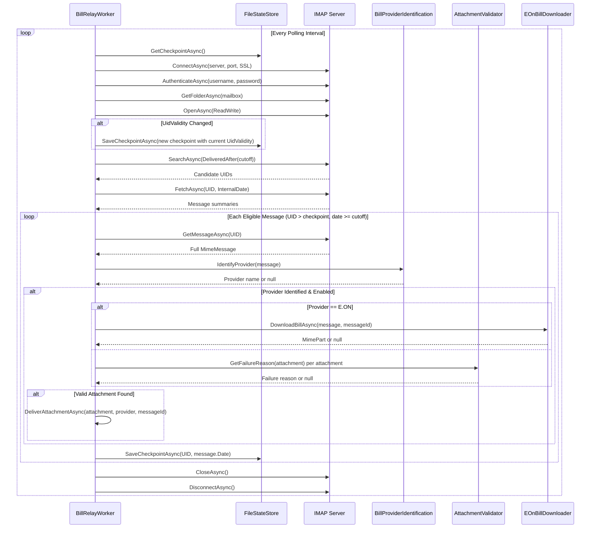

# Inbox Poll and Classification Flow

## Overview

Documents the IMAP polling cycle: connection, search, message fetching, provider identification, and attachment validation.

## Sequence Diagram



## Detailed Steps

### 1. Checkpoint Loading

```csharp
var checkpoint = await _stateStore.GetCheckpointAsync(cancellationToken);
```

Loads `ImapCheckpoint` with:
- `UidValidity` — Mailbox UID validity value
- `LastProcessedUid` — Highest UID processed
- `LastProcessedDate` — Date of last processed message

### 2. IMAP Connection

```csharp
using var client = new ImapClient();
await client.ConnectAsync(_imapSettings.Server, _imapSettings.Port, _imapSettings.IsSslEnabled, cancellationToken);

if (!_imapSettings.IsCertificateValidationEnabled)
    client.ServerCertificateValidationCallback = (_, _, _, _) => true;

await client.AuthenticateAsync(_imapSettings.Username, _imapSettings.Password, cancellationToken);
```

- New connection per poll cycle
- Certificate validation configurable (default: enabled)
- Auth: username/password (no OAuth)

### 3. Mailbox Selection

```csharp
var mailbox = await client.GetFolderAsync(_imapSettings.Mailbox, cancellationToken);
await mailbox.OpenAsync(FolderAccess.ReadWrite, cancellationToken);
```

- Opens configured mailbox (default: INBOX)
- ReadWrite access (needed for flags if used later)

### 4. UID Validity Check

```csharp
if (checkpoint.UidValidity != mailbox.UidValidity.ToString())
{
    checkpoint = new ImapCheckpoint { UidValidity = mailbox.UidValidity.ToString() };
    await _stateStore.SaveCheckpointAsync(checkpoint, cancellationToken);
}
```

- If `UidValidity` changed → reset checkpoint (full rescan within age window)
- Safety mechanism against UID reuse after mailbox rebuild

### 5. Cutoff Calculation

```csharp
var cutoff = EmailAgePolicy.GetCutoff(
    _pollingSettings,
    DateTimeOffset.UtcNow,
    checkpoint.LastProcessedDate);
```

Effective cutoff = max of:
1. `DateTimeOffset.UtcNow - MaximumEmailAgeDays`
2. `InitialProcessingDate` (if configured)
3. `checkpoint.LastProcessedDate` (if exists)

### 6. Message Search

```csharp
var query = SearchQuery.DeliveredAfter(cutoff);
var uids = await mailbox.SearchAsync(query, cancellationToken);
```

- Server-side coarse filter using `DeliveredAfter`
- Returns UIDs of messages delivered after cutoff date

### 7. Summary Fetch & Filtering

```csharp
var summaries = await mailbox.FetchAsync(uids, MessageSummaryItems.UniqueId | MessageSummaryItems.InternalDate, cancellationToken);

foreach (var summary in summaries.OrderBy(s => s.UniqueId.Id))
{
    if (summary.UniqueId.Id <= checkpoint.LastProcessedUid) continue;
    if (!EmailAgePolicy.IsEligible(summary.InternalDate, cutoff)) continue;
    // Process message
}
```

Two-stage filtering:
1. UID > `LastProcessedUid` (checkpoint)
2. `InternalDate` >= cutoff (exact, handles server timezone)

### 8. Message Processing

```csharp
var message = await mailbox.GetMessageAsync(uid, cancellationToken);
var provider = BillProviderIdentification.IdentifyProvider(message);

if (provider == null || !_filterSettings.Providers.Contains(provider))
{
    // Skip: unknown or disabled provider
    checkpoint.LastProcessedUid = uid.Id;
    checkpoint.LastProcessedDate = message.Date.UtcDateTime;
    await _stateStore.SaveCheckpointAsync(checkpoint, cancellationToken);
    continue;
}

var attachment = await GetValidAttachmentAsync(message, provider, cancellationToken);
if (attachment != null)
{
    await DeliverAttachmentAsync(attachment, provider, message.MessageId, cancellationToken);
}

checkpoint.LastProcessedUid = uid.Id;
checkpoint.LastProcessedDate = message.Date.UtcDateTime;
await _stateStore.SaveCheckpointAsync(checkpoint, cancellationToken);
```

**Checkpoint advanced after EVERY eligible message** — even if:
- Provider unknown
- Provider disabled
- No valid attachment
- Delivery fails (caught in worker, checkpoint still advances)

### 9. Attachment Retrieval

```csharp
private async Task<MimePart?> GetValidAttachmentAsync(MimeMessage message, string provider, CancellationToken ct)
{
    if (provider == "E.ON")
    {
        return await _eOnBillDownloader.DownloadBillAsync(message, message.MessageId, ct);
    }

    foreach (var attachment in message.Attachments.OfType<MimePart>())
    {
        if (await _attachmentValidator.ValidateAsync(attachment, provider, ct))
            return attachment;
    }
    return null;
}
```

- E.ON: Downloads from link in body
- Others: Validates each attachment via `AttachmentValidator`

### 10. Cleanup

```csharp
await mailbox.CloseAsync(true, cancellationToken);
await client.DisconnectAsync(true, cancellationToken);
```

- `true` = expunge (not used since read-only)
- Disconnect in finally block

## Key Behaviors

| Behavior | Description |
|----------|-------------|
| **Sequential processing** | One message at a time, in UID order |
| **Checkpoint per message** | Advances after each eligible message |
| **UID validity reset** | Full rescan if mailbox rebuilt |
| **No message mutation** | Does not mark read, move, or delete |
| **Age filter: server + client** | IMAP SEARCH + exact InternalDate check |
| **E.ON special handling** | Link-based download, not attachment |

## Failure Handling

| Failure Point | Behavior |
|---------------|----------|
| IMAP connect/auth fails | Exception caught in `ExecuteAsync`, logged, retry next cycle |
| Search/fetch fails | Exception caught, logged, retry next cycle |
| Message fetch fails | Exception caught, logged, continue to next message |
| Provider identification fails | Logged as debug, message skipped, checkpoint advances |
| Attachment validation fails | Logged with reason, next attachment tried |
| E.ON download fails | Logged, message skipped, checkpoint advances |
| Delivery fails | Exception caught in worker, logged, checkpoint advances |

## Configuration Impact

| Setting | Effect on Flow |
|---------|----------------|
| `Polling.IntervalSeconds` | Delay between poll cycles |
| `Polling.MaximumEmailAgeDays` | Rolling window lower bound |
| `Polling.InitialProcessingDate` | Explicit lower bound (overrides age) |
| `Filters.Providers` | Whitelist of enabled providers |
| `Imap.Mailbox` | Target mailbox folder |
| `Imap.ValidateCertificates` | TLS certificate validation |

## Related Documentation

- [Components: BillRelayWorker](../components/bill-relay-worker.md)
- [Components: BillProviderIdentification](../components/bill-provider-identification.md)
- [Components: AttachmentValidator](../components/attachment-validator.md)
- [Components: EOnBillDownloader](../components/eon-bill-downloader.md)
- [Architecture: Inbox Processing](../architecture.md#inbox-processing)
- [Data Model: Provider Identification](../data-model.md#provider-identification)