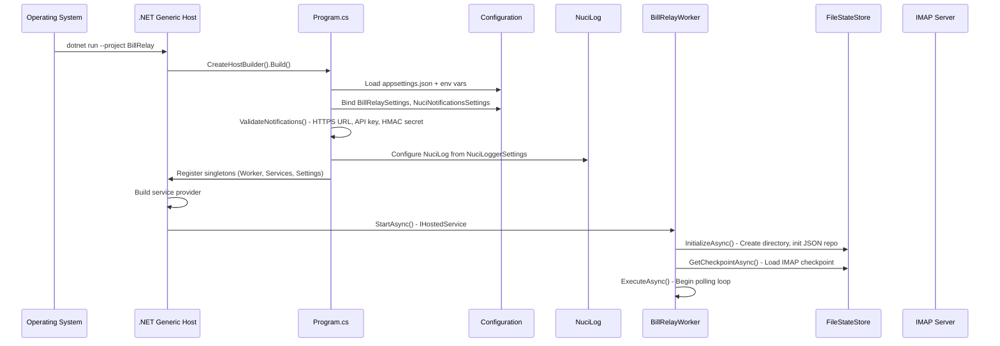

# Startup and Rendering Flow

## Overview

Documents the application startup sequence from process entry to worker execution.

## Sequence Diagram



## Detailed Steps

### 1. Host Creation (`Program.cs`)

```csharp
var builder = Host.CreateApplicationBuilder(args);
builder.Configuration
    .SetBasePath(AppContext.BaseDirectory)
    .AddJsonFile("appsettings.json", optional: false, reloadOnChange: false)
    .AddEnvironmentVariables();
```

- Base path = output directory (where `appsettings.json` is copied)
- JSON required (`optional: false`)
- No hot reload (`reloadOnChange: false`)
- Environment variables override JSON

### 2. Configuration Binding

```csharp
builder.Services.Configure<BillRelaySettings>(builder.Configuration);
builder.Services.Configure<NuciNotificationsSettings>(
    builder.Configuration.GetSection("NuciNotificationsSettings"));
```

All settings classes in `BillRelay.Configuration` namespace.

### 3. Notification Validation

```csharp
static void ValidateNotifications(NuciNotificationsSettings settings)
{
    if (!Uri.TryCreate(settings.BaseUrl, UriKind.Absolute, out var uri) ||
        uri.Scheme != "https")
        throw new InvalidOperationException("BaseUrl must be absolute HTTPS");
    if (string.IsNullOrWhiteSpace(settings.ApiKey))
        throw new InvalidOperationException("ApiKey required");
    if (string.IsNullOrWhiteSpace(settings.HmacSharedSecretKey))
        throw new InvalidOperationException("HmacSharedSecretKey required");
}
```

Fails fast at startup if invalid.

### 4. Service Registration

All services registered as **singletons**:

```csharp
builder.Services.AddSingleton<BillRelayWorker>();
builder.Services.AddSingleton<IAttachmentValidator, AttachmentValidator>();
builder.Services.AddSingleton<IEOnBillDownloader, EOnBillDownloader>();
builder.Services.AddSingleton<IAttachmentProcessor, AttachmentProcessor>();
builder.Services.AddSingleton<IBillDelivery, BillDelivery>();
builder.Services.AddSingleton<IBillSender, BillSender>();
builder.Services.AddSingleton<IStateStore, FileStateStore>();
builder.Services.AddHttpClient();
builder.Services.AddSingleton<EmailAgePolicy>();
builder.Services.AddLogging(logging => logging.AddNuciLog());
```

### 5. Hosted Service Startup

`BillRelayWorker` implements `BackgroundService`:

```csharp
protected override async Task ExecuteAsync(CancellationToken stoppingToken)
{
    // Validate polling interval
    if (_pollingSettings.IntervalSeconds <= 0)
        throw new InvalidOperationException("IntervalSeconds must be > 0");

    // Initialize state store
    await _stateStore.InitializeAsync(stoppingToken);

    // Load checkpoint
    var checkpoint = await _stateStore.GetCheckpointAsync(stoppingToken);

    // Polling loop
    while (!stoppingToken.IsCancellationRequested)
    {
        await ProcessInboxAsync(stoppingToken);
        await Task.Delay(TimeSpan.FromSeconds(_pollingSettings.IntervalSeconds), stoppingToken);
    }
}
```

### 6. State Store Initialization

```csharp
public async Task InitializeAsync(CancellationToken cancellationToken)
{
    string stateFilePath = settings.Value.Storage.StateFilePath;
    string? directory = Path.GetDirectoryName(stateFilePath);
    if (!string.IsNullOrEmpty(directory))
        Directory.CreateDirectory(directory);

    if (!File.Exists(stateFilePath))
        await File.WriteAllTextAsync(stateFilePath, "[]", cancellationToken);

    repository = new JsonRepository<ProcessedAttachmentDataObject>(stateFilePath);
}
```

- Creates state directory if missing
- Creates empty JSON array if file missing
- Initializes NuciDAL JsonRepository

### 7. Checkpoint Loading

```csharp
public async Task<ImapCheckpoint> GetCheckpointAsync(CancellationToken cancellationToken)
{
    string checkpointPath = GetCheckpointPath(); // stateFilePath + ".checkpoint"
    if (!File.Exists(checkpointPath))
        return new ImapCheckpoint(); // Empty = first run

    string json = await File.ReadAllTextAsync(checkpointPath, cancellationToken);
    return JsonSerializer.Deserialize<ImapCheckpoint>(json) ?? new ImapCheckpoint();
}
```

- Returns empty checkpoint on first run (UidValidity=0, LastProcessedUid=0)
- On subsequent runs: loads UidValidity, LastProcessedUid, LastProcessedDate

## Configuration Validation Summary

| Setting | Validation | Timing |
|---------|------------|--------|
| `Polling.IntervalSeconds` | > 0 | Worker startup |
| `Polling.MaximumEmailAgeDays` | > 0 | Cutoff calculation |
| `Imap.Server` | Non-empty | IMAP connect (implicit) |
| `Imap.Username` | Non-empty | IMAP auth (implicit) |
| `Imap.Password` | Non-empty | IMAP auth (implicit) |
| `Delivery.Recipient` | Valid email | `BillSender.ValidateConfiguration` |
| `Delivery.TemplatePath` | File exists, valid XML | `BillSender.ValidateConfiguration` |
| `NuciNotifications.BaseUrl` | Absolute HTTPS | `Program.ValidateNotifications` |
| `NuciNotifications.ApiKey` | Non-empty | `Program.ValidateNotifications` |
| `NuciNotifications.HmacSharedSecretKey` | Non-empty | `Program.ValidateNotifications` |

## Failure Modes

| Failure Point | Behavior |
|---------------|----------|
| Missing `appsettings.json` | Host build throws |
| Invalid JSON | Host build throws |
| Notification validation fails | Host build throws |
| State directory creation fails | `InitializeAsync` throws, worker stops |
| State file write fails | `InitializeAsync` throws, worker stops |
| Checkpoint read fails | `GetCheckpointAsync` throws, worker stops |

## Related Documentation

- [Configuration](../configuration.md) — Settings schema and precedence
- [Components: BillRelayWorker](../components/bill-relay-worker.md) — Worker orchestration
- [Components: FileStateStore](../components/file-state-store.md) — State persistence
- [Architecture: Composition and Configuration](../architecture.md#composition-and-configuration)